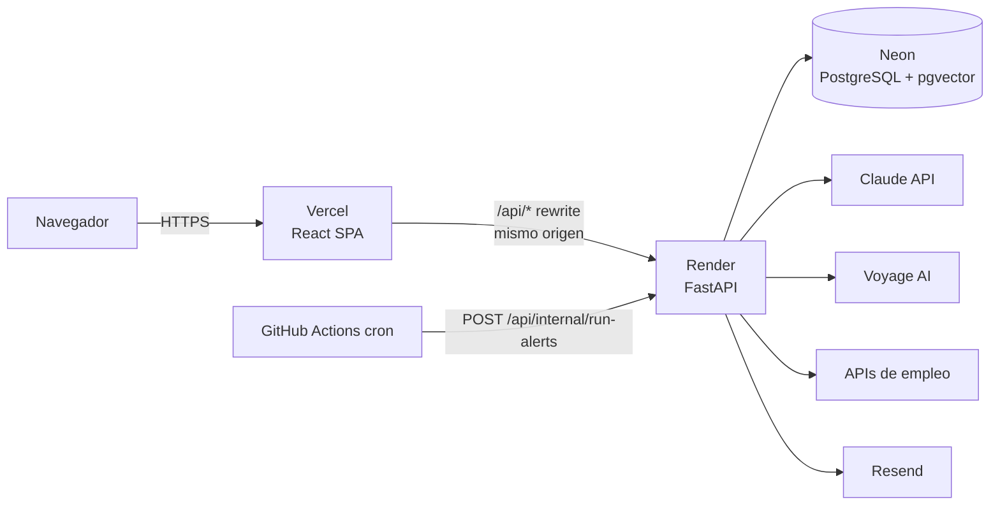
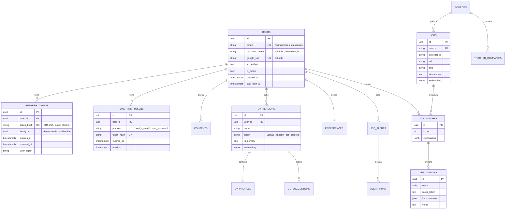
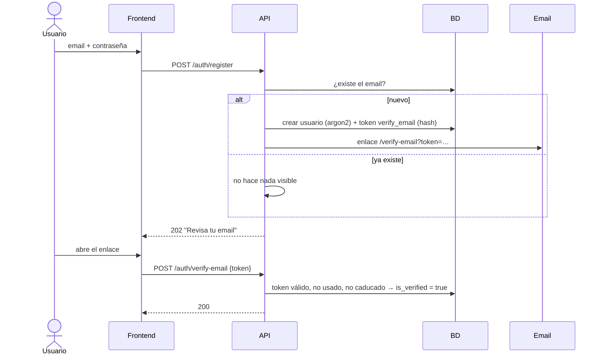
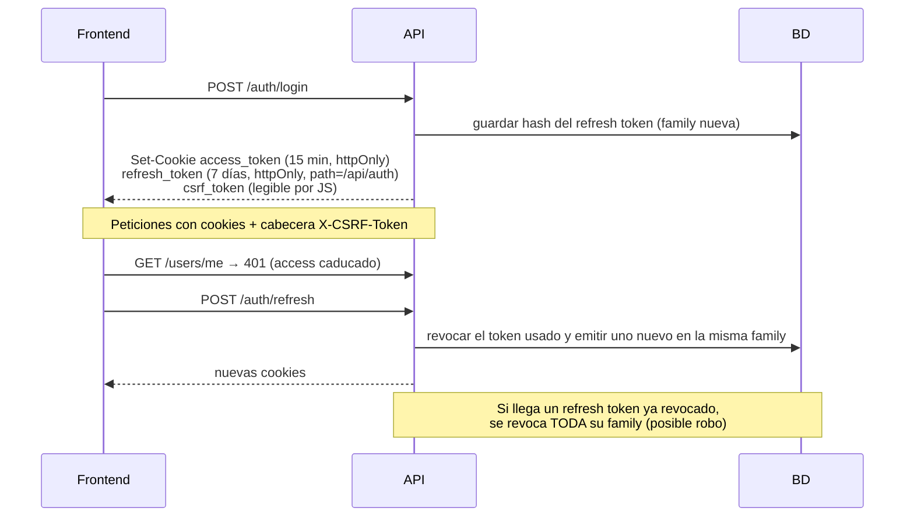

# Diseño del sistema

> Sprint 1 · Versión 1.0 · 16/11/2026
> Los diagramas usan [Mermaid](https://mermaid.js.org/), que GitHub muestra directamente.

## 1. Arquitectura



**Decisiones clave:**
- **Mismo origen:** Vercel reenvía `/api/*` al backend de Render. Así las cookies de sesión son *first-party* (`SameSite=Lax`), no hace falta CORS en producción y se reduce la superficie de CSRF ([ADR-0004](adr/0004-autenticacion-y-sesion.md)).
- **Backend por capas:**
  - `api/` (routers HTTP, sin lógica de negocio)
  - → `services/` (casos de uso)
  - → `repositories/` (acceso a datos)
  - → `models/` (ORM)
  - Los esquemas de entrada y salida están en `schemas/` (Pydantic).
- **Tareas en segundo plano:** una tabla `jobs_queue` en PostgreSQL (`SELECT … FOR UPDATE SKIP LOCKED`), a partir del Sprint 3.
- **Fuentes de empleo:** patrón *adapter* con la interfaz `JobSource` (Sprint 3).

### Estructura del backend

```
backend/app/
├── main.py              # crea la app, middlewares y routers
├── core/
│   ├── config.py        # Settings (pydantic-settings, solo variables de entorno)
│   ├── db.py            # engine y sesión async de SQLAlchemy
│   ├── security.py      # hash argon2, JWT, tokens aleatorios
│   ├── logging.py       # structlog JSON + request id
│   ├── errors.py        # excepciones de dominio y handlers
│   └── rate_limit.py    # slowapi
├── models/              # User, RefreshToken, OneTimeToken…
├── schemas/
├── repositories/
├── services/            # auth_service, google_oauth, mailer
└── api/                 # deps.py, routes/auth.py, routes/users.py, routes/health.py
```

## 2. Modelo de datos

ERD completo previsto. En el Sprint 1 solo se implementan `users`, `refresh_tokens` y `one_time_tokens`.



## 3. API del Sprint 1

Todas las rutas cuelgan de `/api`. Los errores siguen un formato único: `{"error": {"code": "...", "message": "..."}}`.

| Método | Ruta | Auth | Descripción |
|---|---|---|---|
| GET | `/health` | — | Estado de la API y de la BD |
| POST | `/auth/register` | — | Registro. **Siempre responde 202**, aunque el email ya exista (evita enumerar usuarios) |
| POST | `/auth/verify-email` | — | Verifica el email con un token de un solo uso (24 h) |
| POST | `/auth/resend-verification` | — | Reenvía la verificación (202 siempre) |
| POST | `/auth/login` | — | Comprueba las credenciales, crea las cookies de sesión y devuelve el usuario |
| POST | `/auth/refresh` | cookie de refresco | Rota el refresh token |
| POST | `/auth/logout` | sesión | Revoca el refresh token y borra las cookies |
| POST | `/auth/password/forgot` | — | Envía el email de recuperación (202 siempre) |
| POST | `/auth/password/reset` | — | Cambia la contraseña con un token (1 h) y cierra todas las sesiones |
| GET | `/auth/google/login` | — | Redirige a Google (OAuth 2.0 + PKCE + `state`) |
| GET | `/auth/google/callback` | — | Valida `state`, intercambia el código, verifica el `id_token` y crea la sesión |
| GET | `/users/me` | sesión | Usuario actual |

### API del Sprint 2 (CVs y preferencias)

Todas estas rutas requieren sesión y filtran por el usuario autenticado. Si alguien pide un recurso de otro usuario, la respuesta es 404, igual que si no existiera.

| Método | Ruta | Descripción |
|---|---|---|
| GET | `/cvs?include_archived=` | Lista de versiones del CV (la principal primero) |
| POST | `/cvs` (multipart) | Sube un PDF/DOCX o el PDF de LinkedIn (`origin=upload\|linkedin_pdf`, `consent`, `name`). Extrae el texto, analiza con IA y aplica el *grounding* ([ADR-0005](adr/0005-procesamiento-de-cv.md)) |
| POST | `/cvs/blank` | Crea una versión vacía para rellenar a mano |
| GET | `/cvs/{id}` | Versión con su perfil y las notas de extracción (datos no verificados, modelo, versión del prompt) |
| PATCH | `/cvs/{id}` | Renombra, marca como principal o archiva/restaura |
| PUT | `/cvs/{id}/profile` | Guarda el perfil editado por el usuario |
| POST | `/cvs/{id}/extract` | Vuelve a analizar con IA (con cuota diaria) |
| DELETE | `/cvs/{id}` | Borra la versión; si era la principal, otra pasa a serlo |
| GET/PUT | `/preferences` | Preferencias de búsqueda (puestos, ubicaciones, modalidad, salario, fuentes) |

**Cambio respecto al ERD:** el perfil se guarda como columna JSON (`cv_versions.profile`) en lugar de en una tabla `cv_profiles` aparte. La relación es 1 a 1, siempre se lee junto a la versión y su forma la valida Pydantic (`CvProfile`). Tablas nuevas: `cv_versions`, `preferences`, `consents` y `ai_usage`.

La documentación interactiva (OpenAPI) se genera sola en `/api/docs` (desactivada en producción).

## 4. Flujos principales

### 4.1 Registro y verificación



### 4.2 Sesión: login, refresco y reutilización



### 4.3 Login con Google

1. `GET /auth/google/login`: se generan `state` y `code_verifier` (PKCE), se guardan en una cookie temporal firmada y se redirige a Google con los permisos `openid email profile`.
2. `GET /auth/google/callback`: se comprueba `state` y se intercambia el código por tokens. Después se verifica la firma, la audiencia y el emisor del `id_token` con las claves públicas de Google (JWKS), y se exige `email_verified = true`.
3. Se busca el usuario por `google_sub` o por email:
   - Si existe con contraseña y email verificado, se vincula la cuenta.
   - Si no existe, se crea ya verificado.
4. Se crea la sesión igual que en el login normal y se redirige al panel.

## 5. Pantallas (wireframes de baja fidelidad)

| Pantalla | Ruta | Contenido | Sprint |
|---|---|---|---|
| Inicio | `/` | Propuesta de valor, botones "Crear cuenta" e "Iniciar sesión" | 1 |
| Registro | `/register` | Email, contraseña con indicador de fortaleza, consentimiento, botón de Google | 1 |
| Login | `/login` | Email, contraseña, "¿Olvidaste tu contraseña?", botón de Google | 1 |
| Verificar email | `/verify-email` | Estado de la verificación y reenvío | 1 |
| Recuperar / restablecer | `/forgot-password`, `/reset-password` | Formularios simples | 1 |
| Panel | `/app` | Barra lateral (Ofertas, CVs, Candidaturas, Alertas, Estadísticas, Cuenta) y contenido | 1 (vacío) → 2–5 |
| CVs | `/app/cvs` | Lista de versiones, subir CV o PDF de LinkedIn, editor de perfil | 2 |
| Ofertas | `/app/jobs` | Tarjetas con puntuación, filtros y "Preparar candidatura" | 3 |
| Preparar candidatura | `/app/jobs/:id/prepare` | Carta, respuestas, adaptación del CV y "Ir a la oferta" | 4 |
| Candidaturas | `/app/applications` | Tablero por estados | 4 |
| Alertas / Estadísticas | `/app/alerts`, `/app/stats` | Gestión de alertas, gráficos | 5 |

```
┌──────────────────────────────────────────────────────────┐
│ JobPilot AI                              [usuario ▾]     │
├──────────────┬───────────────────────────────────────────┤
│ ▸ Ofertas    │  Ofertas recomendadas      [filtros ▾]    │
│   CVs        │  ┌─────────────────────────────────────┐  │
│   Candidat.  │  │ Backend Developer · Acme · Remoto  │  │
│   Alertas    │  │ ●●●●○ 86/100  "Encaja por Python…" │  │
│   Estadíst.  │  │ [Preparar candidatura] [Guardar]   │  │
│   Cuenta     │  └─────────────────────────────────────┘  │
└──────────────┴───────────────────────────────────────────┘
```

## 6. Frontend

- **Navegación:** React Router con rutas públicas y protegidas (`<RequireAuth>`).
- **Estado del servidor:** React Query. El usuario actual es la consulta `['me']`.
- **Cliente HTTP** (`src/api/client.ts`):
  - Usa `fetch` con `credentials: 'include'`.
  - Envía la cabecera `X-CSRF-Token` en las peticiones que modifican datos.
  - Ante un 401, intenta una vez `POST /auth/refresh`.
- **Estilos:** Tailwind CSS. Los formularios son accesibles (etiquetas, errores asociados y foco visible).
